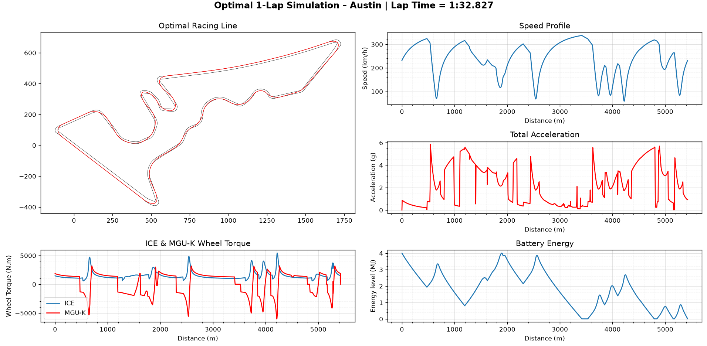

# Minimum-Lap-Time Optimization of a 2026-Spec F1 Car

Optimal control of a hybrid Formula 1 car (point-mass model, ICE + MGU-K) around real circuits. The racing line, speed profile, torque split and battery deployment are optimized **simultaneously** by minimizing lap time, formulated as a nonlinear program (NLP) with [CasADi](https://web.casadi.org/) and solved with Ipopt.

> **Status: work in progress.** This is the baseline (v1) model. A four-wheel model with Pacejka tyres is under development (see [Roadmap](#roadmap)).



## Results

Predicted lap times vs. **2026 pole position laps**, with **the same car parameters on every circuit** (no per-track tuning). A pole lap is a single flying lap on fresh tyres and low fuel, which is the scenario the optimizer models (no traffic, no tyre degradation). Circuits are listed in 2026 calendar order.

| Circuit | Pole position (2026) | Model | Δ (s) | Δ (%) | Solve time (s) |
|---|---|---|---|---|---|
| Shanghai | 1:32.064 | 1:33.591 | +1.527 | +1.66 | 7.3 |
| Suzuka | 1:28.778 | 1:28.433 | −0.345 | −0.39 | 4.5 |
| Montreal | 1:12.578 | 1:13.339 | +0.761 | +1.05 | 2.8 |
| Spielberg | 1:06.113 | 1:07.245 | +1.132 | +1.71 | 4.0 |
| Silverstone | 1:28.111 | 1:26.976 | −1.135 | −1.29 | 7.4 |
| Spa | 1:44.361 | 1:46.002 | +1.641 | +1.57 | 13.6 |
| Budapest | 1:17.207 | 1:18.600 | +1.393 | +1.80 | 3.3 |
| Zandvoort | 1:11.163 | 1:14.279 | +3.116 | +4.38 | 3.2 |
| Monza | 1:21.786 | 1:22.605 | +0.819 | +1.00 | 4.6 |
| Sepang | 1:35.130 | 1:30.966 | −4.164 | −4.38 | 24.3 |
| Austin | 1:34.035 | 1:32.827 | −1.208 | −1.28 | 15.3 |
| Mexico City | 1:16.514 | 1:15.113 | −1.401 | −1.83 | 13.8 |
| *Yas Marina* | *pending (GP not yet held)* | *1:38.991* | – | – | *6.8* |

**Mean absolute error: 1.55 s (1.9 %)** over the 12 completed dry circuits, with a mean signed error of **+0.18 s** (virtually no systematic bias) and an **average solve time of 8.5 s** (wall-clock) across all 13 circuits. Excluded from the comparison: **Melbourne** and **Catalunya** (the TUMFTM database uses outdated pre-2022/2023 chicane layouts), **São Paulo** (wet qualifying session), and **Yas Marina** (pre-race prediction).

### Sources of error

These results should be read as a validation of the order of magnitude and of the method, not as a precise reproduction of real lap times. The main error sources are:

**1. Car parameters (largest source)**
- Mass, $C_x$, $C_z$, $\mu$, gear ratios and the ICE / MGU-K maps are **estimates** for a 2026-spec car, not official data. Real values are confidential and change between teams, circuits and setups.
- Aero coefficients are constant, whereas teams run different downforce levels per circuit (Monza vs. Zandvoort, for example) and the 2026 cars have active aerodynamics, which is not modelled.

**2. Track and environment**
- Track data is an approximation: centerline and widths come from a public database, and layouts, kerbs and run-off areas may differ from the 2026 configuration. Coarse discretization also slightly changes the path length.
- Flat track: no elevation and no banking (Zandvoort has banked corners; Spa and Austin have large elevation changes).
- Constant air density, whereas Mexico City sits at ~2200 m.
- Weather and surface conditions are not modelled: air and track temperature, wind, humidity, rain, surface roughness and resurfacing, and grip evolution during a session. A constant friction coefficient $\mu$ across all circuits is a strong simplification, since grip varies a lot between tracks.

**3. Vehicle model**
- Point mass: no load transfer, no front/rear balance, no tyre dynamics (slip, load sensitivity, temperature, wear). No ride height or aero map effects.
- No slipstream, no gear shift time, no rolling resistance, and no transient dynamics.
- Simplified energy management: the battery level is not forced to be cyclic over the lap, and there is no harvesting efficiency or deployment strategy imposed by the regulations.

**4. Optimizer vs. reality**
- The optimizer is a *perfect driver*: it finds the global-quality optimum for the model, whereas a real pole lap contains small driver errors, compromises for tyre warm-up and traffic management.
- Real pole laps are one sample: they depend on the session conditions and on what each driver extracts on the day.

Errors of different signs partially compensate: a model that is too optimistic in grip can be offset by one that is too pessimistic in power, so a small error on one circuit is not proof that the model is accurate there.

## Model

**Decision variables** at each of the *n* nodes of the track reference line: velocity vector $(v_x, v_y)$, lateral offset $d$ from the centerline, ICE torque $T_{ICE}$, MGU-K torque $T_{K}$, and battery energy $E$ (6n variables in total).

**Objective**

$$\min \sum_k \Delta t_k, \qquad \Delta t_k = \frac{2\,\Delta s_k}{V_k + V_{k+1}}$$

**Constraints**

- **Longitudinal dynamics** (wheel torque balance, including wheel inertia $J$ and aero drag):

$$\left(\frac{J}{R} + R\,m\right) a_k \le T_{ICE} + T_{K} - \tfrac12 R \rho S C_x V_k^2$$

- **Tyre grip** (friction circle with aerodynamic downforce):

$$\left(m a_k + \tfrac12 \rho S C_x V^2\right)^2 + \left(m V \dot\theta\right)^2 \le \mu^2 \left(m g + \tfrac12 \rho S C_z V^2\right)^2$$

- **Velocity tangent to the trajectory**, a closed lap (periodic velocity) and track limits $-W_{right} \le d \le W_{left}$.
- **Powertrain limits**: $0 \le T_{ICE} \le T_{ICE}^{max}(V)$ and $|T_K| \le T_K^{max}(V)$ (torque and power-limited MGU-K), with the optimal gear chosen as the one maximizing power.
- **Battery**: $E_{k+1} - E_k = -T_K \, \Delta s_k / R$, with $0 \le E \le E_{max}$.

**Solving**: the NLP is discretized along the track, with automatic differentiation by CasADi (`SX`) and an interior-point solve with Ipopt. The initial guess is a constant-speed profile along the centerline.

**Notes**
- The dynamics constraint is written as an inequality: any excess torque is dissipated by the brake.
- Max torque curves vs. speed are 5th-degree polynomial fits of the gear-optimized powertrain, computed once at import.

## Project structure

```
.
├── optimisation.py   # Track, NLP formulation, solver, plots
├── powertrain.py     # ICE / MGU-K maps, gear selection, torque-vs-speed fits
├── params.py         # Car parameters (single source of truth)
├── tracks/           # Circuit CSVs (centerline + track widths)
└── docs/             # Figures
```

## Getting started

```bash
git clone <repo-url>
cd <repo>
pip install -r requirements.txt
python optimisation.py
```

The default circuit is Austin. Change it in the `__main__` block: any file in `tracks/` works.

## Roadmap

- [ ] **Pacejka "Magic Formula"** tyre model, with coefficients reverse-engineered from [FastF1](https://github.com/theOehrly/Fast-F1) telemetry
- [ ] **Four-wheel model**: per-wheel force distribution, load transfer, aero balance and configurable setups
- [ ] **Car database** to store and compare several cars / configurations
- [ ] **Simple, intuitive interface** to run and visualize simulations

## Credits

Circuit data from the [TUMFTM racetrack-database](https://github.com/TUMFTM/racetrack-database).
